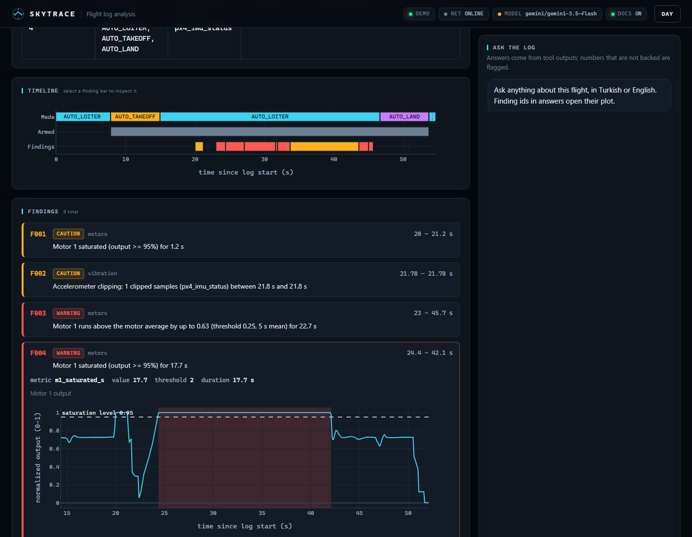
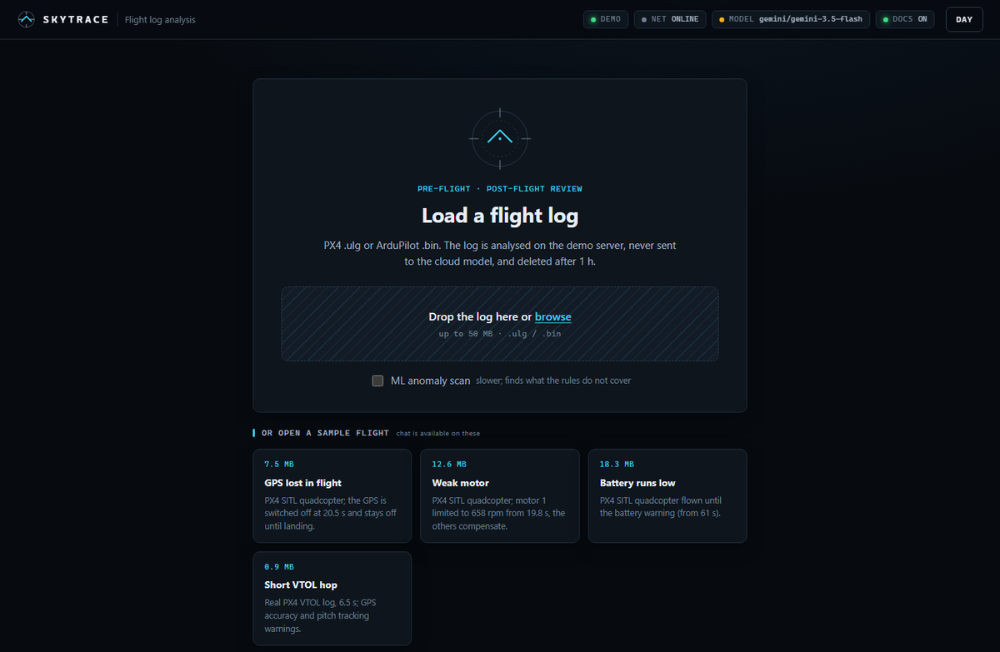
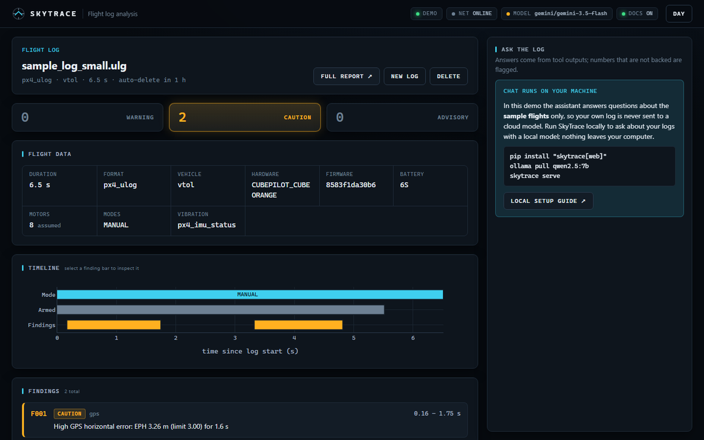

# SkyTrace

[](https://github.com/beyzanurulu/SkyTrace/actions/workflows/ci.yml)
[](https://pypi.org/project/skytrace/)
[](https://pypi.org/project/skytrace/)
[](LICENSE)

Flight log analysis for **PX4** (`.ulg`) and **ArduPilot** (`.bin`) drones: rule
and anomaly detectors, an offline HTML report, a web UI, and a Q&A assistant whose
every number is checked against the log. Runs fully locally (local LLM, local
documentation index), with an enforced offline mode.

**Live demo:** <https://skytrace-demo.onrender.com> (free server: the first load can take a minute) ·
**Sample reports:** <https://beyzanurulu.github.io/SkyTrace/>



## What it does

- **Parses** PX4 ULog and ArduPilot DataFlash logs into one schema (attitude,
  GPS, battery, vibration, motors, position, events).
- **Detects problems** with rule-based detectors (vibration and accelerometer
  clipping, GPS accuracy / fix / data loss, battery sag and low charge, attitude
  tracking, motor saturation and imbalance) and, optionally, unsupervised
  anomaly detection (rolling robust z-score per signal and flight mode).
- **Reports** each finding with its time range, the value against its threshold
  and an evidence plot: a single-file HTML report that opens offline, JSON, or a
  terminal table.
- **Answers questions** about the log ("When did the GPS fail?", "Titreşimi nasıl
  azaltırım?"): a LangGraph agent with tools over the parsed log, a local model by
  default (Ollama), and a verification step that flags every number, finding id
  or link that no tool returned. "Why / how to fix" questions are answered from
  the PX4 and ArduPilot documentation, with links to the pages used.
- **Web UI** with the findings, interactive plots and the chat side by side;
  works on phones too.

## Quick start

```
pip install "skytrace[web]"
skytrace analyze flight.ulg              # -> flight.html, findings in the terminal
skytrace serve                           # web UI on http://127.0.0.1:8000
```

The assistant needs a model. The default is local ([Ollama](https://ollama.com)):

```
ollama pull qwen2.5:7b
skytrace chat flight.ulg --ask "What went wrong in this flight?"
```

Optional documentation search for the assistant (downloads the PX4 and ArduPilot
docs once, about 3 minutes, everything stays in `data/`):

```
ollama pull bge-m3
skytrace docs build
```

No log at hand? [`samples/`](samples/) has three simulated flights (GPS loss,
weak motor, low battery) and a short real VTOL flight; `skytrace serve` started in
the repository offers them in the UI. A [sample report](https://github.com/beyzanurulu/SkyTrace/releases/latest/download/skytrace-sample-report.html)
(the weak-motor flight, HTML download) is attached to each release.

## Usage

```
skytrace analyze flight.bin --format json -o out.json   # ArduPilot, JSON
skytrace analyze flight.ulg --ml                        # + anomaly detection
skytrace chat flight.ulg                                # interactive Q&A
skytrace chat flight.ulg --model gemini/gemini-3.5-flash  # any LiteLLM model
skytrace docs search "vibration too high"               # the documentation index
skytrace serve --port 8080
```

```python
from skytrace import FlightLog, load_config
from skytrace.detectors import run_detectors

log = FlightLog.from_file("flight.ulg")
for f in run_detectors(log, load_config()).findings:
    print(f.id, f.severity, f.t_start, f.summary)
```

Every threshold and default is configurable (`-c my.yaml` overrides
`src/skytrace/defaults.yaml`) and documented in [docs/thresholds.md](docs/thresholds.md).

| Upload page with the sample flights | Chat on your own logs runs locally |
|---|---|
|  |  |

## Offline mode

`SKYTRACE_MODE=offline` guarantees that nothing leaves the machine: the chat and
embedding models must be local, every outgoing connection except to the model
server is refused (an error instead of a silent leak), and nothing is downloaded
at run time. The web UI shows the mode in its status bar.

```
export SKYTRACE_MODE=offline        # PowerShell: $env:SKYTRACE_MODE = "offline"
skytrace serve
```

With Docker (Ollama + SkyTrace; the first start downloads the models):

```
docker compose up --build                                                  # CPU
docker compose -f docker-compose.yml -f docker-compose.gpu.yml up --build  # GPU >= 6 GB
```

Use the GPU override only if the model fits in GPU memory: on a 4 GB laptop GPU
the split model ran ten times slower in Docker than on the CPU alone. Give Docker
enough memory (Windows: `memory=11GB` under `[wsl2]` in `%USERPROFILE%\.wslconfig`).

The app image is also published: `ghcr.io/beyzanurulu/skytrace` (it expects a
model server, see `docker-compose.yml`). An all-in-one image with the models and
the documentation index inside (about 9.5 GB, built locally, not published) runs
with no network at all:

```
skytrace docs build
docker build -f docker/Dockerfile.bundle -t skytrace:bundle .
docker run --rm --network none skytrace:bundle python eval/offline_e2e.py
```

## Results

All numbers come from the scripts in [`eval/`](eval/); details in
[eval/results/](eval/results/).

**Detectors** on 35 labelled flights (PX4 SITL with injected GPS, battery and
motor faults, plus clean flights; match = same detector, IoU >= 0.3):

| Detector | Labelled faults | Found | Findings | Precision | Recall |
|---|---:|---:|---:|---:|---:|
| GPS | 8 | 8 | 8 | 1.00 | 1.00 |
| Battery | 7 | 7 | 7 | 1.00 | 1.00 |
| Motors | 8 | 8 | 223 | 0.10 | 1.00 |
| Attitude | 1 | 1 | 34 | 0.03 | 1.00 |
| Vibration | 0 | – | 37 | 0.00 | – |

Every fault is found, but the motor, attitude and vibration detectors also raise
many findings outside the labelled fault windows (see *Limitations*).

**Assistant** on 11 questions about a log (expected tools called, every number
backed by a tool output, key facts present):

| Model | Passed | Median latency |
|---|---:|---:|
| `qwen2.5:7b`, local (laptop, RTX 3050 4 GB) | 9 / 11 | 25 s |
| `gemini-3.5-flash`, cloud | 11 / 11 | 15 s |

**Offline:** the end-to-end check in a container with `--network none` passes
7 / 7 (analysis, report, documentation search, two verified answers, web API;
the deliberate connection to the internet is refused, nothing else tries).

## Limitations

- **Evaluation data is mostly simulated.** The labelled set is PX4 SITL; 95
  public Flight Review logs (real PX4 flights) were used to calibrate thresholds
  but are not labelled. ArduPilot parsing is tested, but no ArduPilot flight was
  used for calibration or evaluation.
- **Precision is low for motors and attitude** (many findings outside the fault
  window: a failing motor disturbs the whole flight), and SITL flights trigger a
  one-sample accelerometer-clipping warning at landing.
- **The PX4 vibration level is not checked.** A calibration on 17 real flights
  did not separate good from bad ones (false-alarm rate 1.00 on the test half),
  so the thresholds stay unset and the check is reported as skipped. ArduPilot
  uses the limits recommended by the ArduPilot documentation (30 / 60 m/s²),
  not calibrated on flights. Clipping is checked for both.
- **The local 7B model** misses facts in about 1 of 5 answers and is slow on
  documentation questions (90-105 s on a 4 GB GPU). The verification step flags
  invented numbers, ids and links, but cannot judge whether a backed number is
  used correctly.
- **The web UI has no authentication**; it is meant for localhost. Chat
  sessions live in memory (a restart starts them over); uploads are deleted
  after 24 hours.
- Python 3.11 and 3.12 are tested; Linux and Windows.

## Contributing

See [CONTRIBUTING.md](CONTRIBUTING.md) for the development setup, the checks and
how to add a detector. Changes are listed in [CHANGELOG.md](CHANGELOG.md).

## License and sources

Apache License 2.0, see [LICENSE](LICENSE) and [NOTICE](NOTICE).

- `tests/fixtures/sample_log_small.ulg` (also `samples/px4_vtol_short.ulg`) is the
  test log of [PX4/pyulog](https://github.com/PX4/pyulog) (BSD-3-Clause).
- `samples/px4_sitl_*.ulg` were flown for this project in PX4 SITL.
- `skytrace docs build` downloads documentation to the user's machine; none of it
  is part of this repository or its packages. Passages returned by the assistant
  link to their source page:
  - [PX4 User Guide](https://docs.px4.io/) ([PX4/PX4-Autopilot](https://github.com/PX4/PX4-Autopilot) `docs/`)
    by the PX4 contributors, [CC BY 4.0](https://creativecommons.org/licenses/by/4.0/).
  - [ArduPilot documentation](https://ardupilot.org/copter/)
    ([ArduPilot/ardupilot_wiki](https://github.com/ArduPilot/ardupilot_wiki)) by the
    ArduPilot contributors, [CC BY-SA 3.0](https://creativecommons.org/licenses/by-sa/3.0/).

  Excerpts are split at headings and markup is removed; the text is otherwise unchanged.
